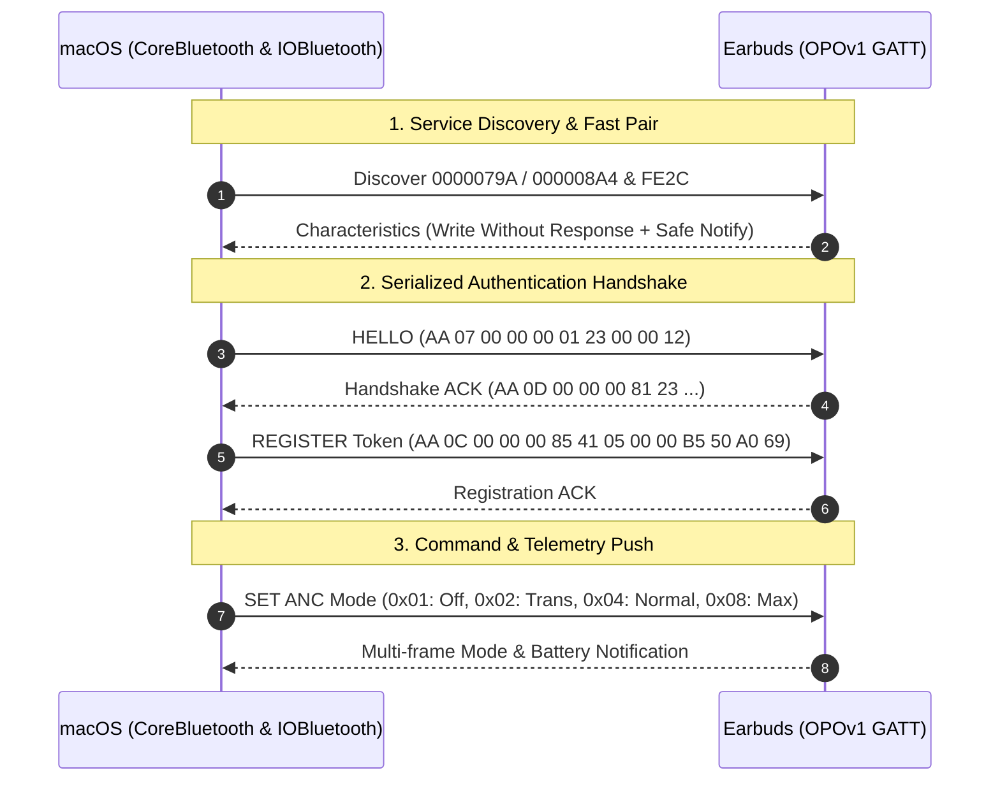

# Buds: Open OnePlus / OPOv1 Earbuds Controller for macOS

<p align="center">
  
</p>

<p align="center">
  <strong>Native macOS menu bar app and CLI utility for OnePlus, Oppo, and Realme earbuds.</strong><br />
  Control Active Noise Cancellation (ANC), Transparency mode, and battery telemetry over Bluetooth Low Energy — no HeyMelody, electron, or phone app required.
</p>

<p align="center">
  <a href="#highlights">Highlights</a> •
  <a href="#device-compatibility">Compatibility</a> •
  <a href="#whats-new-in-v010">What's New</a> •
  <a href="#quick-start">Quick Start</a> •
  <a href="#protocol-architecture">Protocol</a> •
  <a href="#documentation">Documentation</a>
</p>

---

## Highlights

- **Liquid Glass macOS Interface**: Crafted with native SwiftUI Liquid Glass surfaces, specular hover glows, spring-animated expansions, and dynamic SF Symbol transitions.
- **OnePlus Buds Z2 & OPOv1 Family Support**: Full compatibility with both custom 128-bit UUID models (Nord series) and standard 16-bit based UUID models (`000008A4` / `FE2C` Fast Pair).
- **Audio Connection Snatching & Handoff**: Snatch Bluetooth audio from your phone to Mac with a single click via `IOBluetooth` baseband paging. Hand audio back to your phone via the popover disconnect button (`✕`) or a menu bar secondary-click.
- **Instant Case-Open BLE Telemetry**: Decodes manufacturer advertising packets (`Company ID 0x072F`) to display Left, Right, and Case battery percentages the millisecond the lid opens — before the GATT handshake completes.
- **Zero Background Polling**: Pure event-driven architecture that only reads state on-demand or during active popover interactions to protect earbud battery health.
- **Robust Serialized Handshake**: Queues `HELLO` and `REGISTER` auth packets sequentially to eliminate race conditions and prevent firmware connection aborts.
- **Standalone CLI Utility**: Includes `nordbuds.swift` for terminal use, automated scripts, and custom keyboard shortcuts.
- **Zero Heavy Dependencies**: Built entirely with Swift, SwiftUI, and CoreBluetooth. No Xcode required — builds in seconds with Swift Package Manager.

---

## What's New in v0.1.0

- **OnePlus Buds Z2 Support**: Added GATT routing (`000008A4`), multi-frame packet parsing (decoupling concatenated `0xAA` frames), and accurate mapping for Normal (`0x04`) and Max (`0x08`) noise cancellation.
- **Liquid Glass Redesign**: Complete UI overhaul featuring glass cards, interactive metric pills, dynamic status badges, and polished quit controls with accessibility fallbacks.
- **Connection Snatching**: Take over audio playback seamlessly from a connected phone to macOS using baseband paging takeover in `reconnectNow`.
- **Seamless Disconnect**: Release the Bluetooth Classic ACL link to let earbuds instantly fall back to your mobile device.
- **Menu Bar Right-Click Shortcut**: Added `MenuBarRightClickMonitor` for quick secondary-click (or two-finger tap) disconnect directly on the status bar icon.
- **Lid-Open Advertisement Parsing**: Live extraction of earbud and case charge levels directly from BLE broadcast packets.

---

## Device Compatibility

Buds communicates directly over the reverse-engineered **OPOv1** protocol (`0000079A` and `000008A4` services):

| Device Family | Models |
| :--- | :--- |
| **OnePlus** | **Buds Z2**, **Nord Buds 3 Pro**, Nord Buds 2, Buds Pro / Pro 2, Bullets Wireless Z2 |
| **Oppo** | Enco X2, Enco Free2 / Free2i, Enco Air3, Enco Air2 Pro |
| **Realme** | Buds Air 5 Pro, Buds Air 3, Buds Air 2 Pro, Buds T1 |

> [!NOTE]
> Pair your earbuds with macOS in **System Settings > Bluetooth** before launching the app or CLI.

---

## Quick Start

### 1. Menu Bar App

#### Build and Install
Clone the repository and run the install target:

```bash
make install
open ~/Applications/Buds.app
```

This builds a release binary with SPM, packages `Buds.app` into `~/Applications`, and clears macOS quarantine attributes.

#### Development Workflow

```bash
# Build debug binary
make build

# Run unit and protocol self-tests
make test

# Build and launch locally
make run

# Package distribution archive (.app, .zip, .dmg)
make package
```

> [!TIP]
> To launch Buds automatically on login, add `Buds.app` to **System Settings > General > Login Items**.

---

### 2. Command Line Tool (`nordbuds.swift`)

A standalone, single-file Swift CLI tool is available for scriptable control:

```bash
chmod +x nordbuds.swift

./nordbuds.swift on       # Activate Active Noise Cancellation
./nordbuds.swift off      # Deactivate ANC (Normal / Off mode)
./nordbuds.swift trans    # Switch to Transparency mode
./nordbuds.swift battery  # Inspect left, right, and case battery percentages
./nordbuds.swift info     # Print firmware and hardware info
```

---

## Key Features & UI Interactions

### Popover Controls
- **Header Card**: Shows current peripheral name, live status badge, and a quick disconnect (`✕`) action with confirmation popover.
- **Battery Metric Pills**: Real-time percentage readouts for Left earbud, Right earbud, and Charging Case with hover sheens.
- **Noise Control Circles**: Liquid Glass buttons for **Noise Cancellation**, **Off**, and **Transparency** featuring dynamic SF Symbol animations.
- **Connection Snatching**: Tap **Reconnect** while your earbuds are playing audio on your phone — macOS will page the baseband link and snatch connection to your Mac.
- **Secondary Menu Bar Click**: Right-click or two-finger tap the menu bar icon to disconnect and release the earbuds back to your phone without opening the popover.

---

## Protocol Architecture & Reverse Engineering

The communication protocol reverse-engineers the vendor handshake and command frames extracted from HCI packet captures and companion APK analysis.



### Packet Framing

Packets follow an explicit framed format:

```text
+------+------+-----------+------+------+------+------+------+------+------+
| SOF  | LEN  | RESERVED  | CAT  | SUB  | SEQ  | FLAG | D0   | D1   | VAL  |
| 0xAA | 0x0A | 0x00 0x00 | 0x04 | 0x04 | 0x42 | 0x03 | 0x00 | 0x01 | 0x01 |
+------+------+-----------+------+------+------+------+------+------+------+
```

- **SOF (`0xAA`)**: Start of Frame delimiter.
- **LEN**: Packet length payload offset.
- **CAT**: Category (`0x00` System, `0x04` ANC, `0x05` EQ, `0x06` Battery).
- **SUB**: Subcommand (`0x01` Hello, `0x85` Register, `0x04` Set, `0x82` Query).
- **VAL**: Mode selector (`0x01` Off, `0x02` Transparency, `0x04` Normal ANC, `0x08` Max ANC).

> [!IMPORTANT]
> The earbuds only accept writes dispatched with `.withoutResponse`. Standard `.withResponse` GATT writes fail silently.

### Multi-Frame Notifications & BLE Adv Telemetry
- **Concatenated Notifications**: During mode transitions, firmware often batches multiple `0xAA` frames into a single BLE notification. Buds iterates each subframe delimiter to unpack both ANC mode and telemetry payloads.
- **Manufacturer Advertisement Decoding**: When the case lid opens, Company ID `0x072F` broadcast frames provide battery states for left bud, right bud, and case immediately without waiting for GATT connection.

---

## Documentation

Comprehensive engineering documentation is available in [`docs/`](docs/):

- [`docs/device-notes-buds-z2.md`](docs/device-notes-buds-z2.md) — Protocol analysis, UUIDs, multi-frame packets, and connection snatching notes for OnePlus Buds Z2.
- [`docs/device-notes-nord-buds-3-pro.md`](docs/device-notes-nord-buds-3-pro.md) — Nord Buds 3 Pro mappings and service configurations.
- [`docs/architecture.md`](docs/architecture.md) — Architectural overview, concurrency model, and data flow.
- [`docs/no-polling.md`](docs/no-polling.md) — Explanation of the event-driven BLE strategy and battery preservation.
- [`docs/notifications-and-live-updates.md`](docs/notifications-and-live-updates.md) — Notification stream lifecycles and subscription mechanics.
- [`docs/battery-impact.md`](docs/battery-impact.md) — Power consumption analysis and optimization metrics.
- [`docs/debugging.md`](docs/debugging.md) — Detailed logging setup and diagnosis commands.

---

## Troubleshooting

### App shows "Disconnected" or doesn't find earbuds
1. Verify the earbuds are connected to macOS audio in **System Settings > Bluetooth**.
2. Click **Reconnect** in the menu bar popover to initiate baseband paging.
3. If macOS prompts for Bluetooth access, ensure permissions are enabled under **System Settings > Privacy & Security > Bluetooth**.

### Inspecting Real-Time Logs
Stream diagnostic logs live via `Unified Logging`:

```bash
/usr/bin/log stream --predicate 'subsystem == "local.nordbuds"' --info --debug
```

Or launch Buds with verbose standard output:

```bash
BUDS_DEBUG=1 ./scripts/run.sh
```

---

## Credits & Attribution

- **Aasheesh**: Initial OPOv1 protocol reverse engineering, HCI packet analysis, and original reference implementation ([Write-up](https://aasheesh.vercel.app/blog/oneplus-buds) | [Repository](https://github.com/AasheeshLikePanner/cracked-oneplus-buds)).
- **Vedanth**: macOS menu bar application, Swift architecture, CoreBluetooth lifecycle, and multi-model support.
