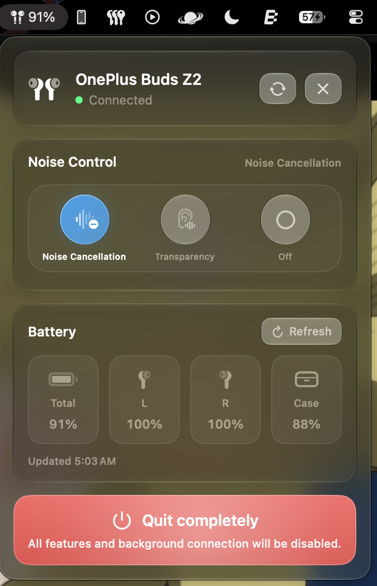

# Buds: Open OnePlus / OPOv1 Earbuds Controller for macOS

<p align="center">
  
</p>

<p align="center">
  <strong>Native macOS menu bar app and CLI utility for OnePlus, Oppo, and Realme earbuds.</strong><br />
  Control Active Noise Cancellation (ANC), Transparency mode, and battery telemetry over Bluetooth Low Energy — no HeyMelody, electron, or phone app required.
</p>

<p align="center">
  <a href="#quick-start">Install</a> •
  <a href="#features">Features</a> •
  <a href="#device-compatibility">Compatibility</a> •
  <a href="#standalone-cli">CLI</a> •
  <a href="CHANGELOG.md">Changelog</a> •
  <a href="docs/">Docs</a>
</p>

---

## Features

- **Liquid Glass macOS Interface**: Native SwiftUI design with specular glass cards, metric pills, and animated SF Symbol transitions.
- **Dynamic Playback Beat Animations**: Bouncing beat and live audio waveform visualizer when media is playing on your Mac.
- **Connection Snatching & Handoff**: Take over audio playback from your phone to Mac with one click. Release the connection anytime to hand it right back.
- **Instant Lid-Open Telemetry**: Decodes BLE manufacturer advertisement packets (`Company ID 0x072F`) for instant battery levels when the case lid opens.
- **Zero Background Polling**: Pure event-driven CoreBluetooth architecture that preserves earbud battery health.
- **Menu Bar Quick Actions**: View battery percentage at a glance; right-click or two-finger tap to disconnect instantly.
- **Lightweight & Standalone**: Swift Package Manager native build with zero heavy dependencies or runtime overhead.

---

## Device Compatibility

Communicates directly over reverse-engineered **OPOv1** BLE services (`0000079A` / `000008A4`):

| Family | Models |
| :--- | :--- |
| **OnePlus** | **Buds Z2**, **Nord Buds 3 Pro**, Nord Buds 2, Buds Pro / Pro 2, Bullets Wireless Z2 |
| **Oppo** | Enco X2, Enco Free2 / Free2i, Enco Air3, Enco Air2 Pro |
| **Realme** | Buds Air 5 Pro, Buds Air 3, Buds Air 2 Pro, Buds T1 |

> [!NOTE]
> Pair your earbuds with macOS in **System Settings > Bluetooth** before launching the app or CLI.

---

## Quick Start

### Option 1: Download Prebuilt Release
Download the latest `Buds.dmg` or `Buds.zip` from [**Releases**](https://github.com/ShubhamJ010/open-oneplus-buds/releases/latest).

### Option 2: Build & Install from Source
```bash
git clone https://github.com/ShubhamJ010/open-oneplus-buds.git
cd open-oneplus-buds
make install
open ~/Applications/Buds.app
```

> [!TIP]
> To launch on system startup, add `Buds.app` to **System Settings > General > Login Items**.

---

## Standalone CLI

A single-file Swift script (`nordbuds.swift`) is included for terminal automation and keyboard shortcuts:

```bash
chmod +x nordbuds.swift

./nordbuds.swift on       # Turn on ANC (Noise Cancellation)
./nordbuds.swift off      # Turn off ANC
./nordbuds.swift trans    # Switch to Transparency mode
./nordbuds.swift battery  # Inspect Left, Right, Case battery
./nordbuds.swift info     # Print device & firmware info
```

---

## Architecture & Documentation

Comprehensive engineering documentation is available in [`docs/`](docs/):

- [`docs/architecture.md`](docs/architecture.md) — Architecture, concurrency model, and data flow.
- [`docs/device-notes-buds-z2.md`](docs/device-notes-buds-z2.md) — Protocol breakdown, packet framing, and GATT routing for OnePlus Buds Z2.
- [`docs/device-notes-nord-buds-3-pro.md`](docs/device-notes-nord-buds-3-pro.md) — Nord Buds 3 Pro mappings and service configs.
- [`docs/no-polling.md`](docs/no-polling.md) — Event-driven BLE strategy and battery preservation.
- [`docs/battery-impact.md`](docs/battery-impact.md) — Power consumption analysis and metrics.
- [`docs/debugging.md`](docs/debugging.md) — Live logging setup and diagnostic commands.

---

## Troubleshooting

- **Earbuds not found / Disconnected**: Ensure the earbuds are connected in macOS **System Settings > Bluetooth**, then click **Reconnect** in the popover.
- **Bluetooth permission**: Grant Bluetooth access under **System Settings > Privacy & Security > Bluetooth** if prompted.
- **Live stream logs**: Run `/usr/bin/log stream --predicate 'subsystem == "local.nordbuds"' --info --debug`

---

## Changelog

See [**CHANGELOG.md**](CHANGELOG.md) for full release notes and version history.

---

## Credits & Attribution

- **Aasheesh**: Initial OPOv1 protocol reverse engineering, HCI packet analysis, and original reference implementation ([Write-up](https://aasheesh.vercel.app/blog/oneplus-buds) | [Repository](https://github.com/AasheeshLikePanner/cracked-oneplus-buds)).
- **Vedanth**: macOS menu bar application, Swift architecture, CoreBluetooth lifecycle, and multi-model support.
