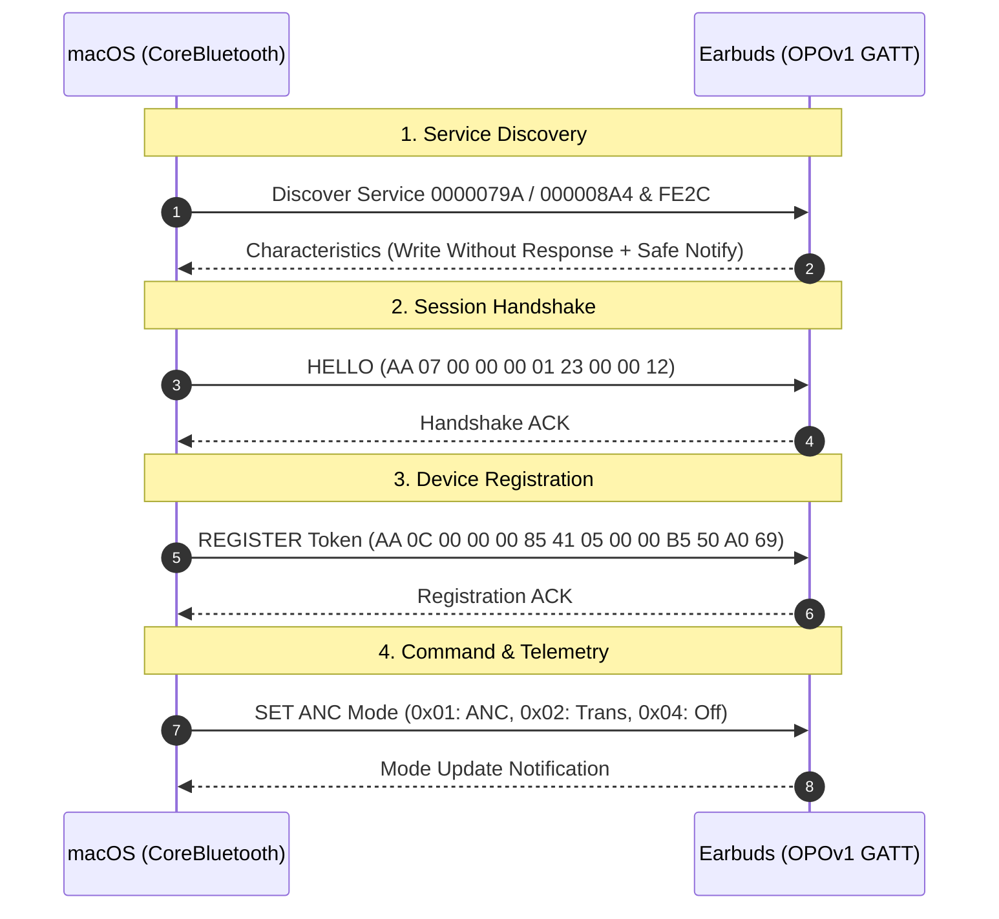

# Buds: Open OnePlus / OPOv1 Earbuds Controller for macOS

<p align="center">
  
</p>

A lightweight, native macOS menu bar application and CLI tool to control Active Noise Cancellation (ANC), Transparency mode, and battery telemetry for OnePlus, Oppo, and Realme earbuds without requiring HeyMelody or an Android device.

---

## Highlights

- **Native macOS Menu Bar App**: Built with Swift and SwiftUI, featuring real-time battery status and ANC mode switching in the menu bar.
- **Direct BLE Hardware Control**: Reverse-engineered implementation of the proprietary OPOv1 protocol over Bluetooth Low Energy.
- **Zero Background Polling**: Event-driven architecture that only reads state on-demand or during active UI interactions to preserve earbud battery.
- **Standalone CLI Utility**: Scriptable CLI (`nordbuds.swift`) for headless automation, keyboard shortcuts, or terminal use.
- **No Xcode Required**: Full build and packaging pipeline powered by Swift Package Manager and lightweight shell scripts.

---

## Device Compatibility

Works across devices running the **OPOv1** protocol (`0000079A` / `000008A4` services):

| Device Family | Confirmed / Supported Models |
| :--- | :--- |
| **OnePlus** | OnePlus Nord Buds 3 Pro, OnePlus Buds Z2, Nord Buds 2, Buds Pro / Pro 2, Bullets Wireless Z2 |
| **Oppo** | Enco X2, Enco Free2 / Free2i, Enco Air3, Enco Air2 Pro |
| **Realme** | Buds Air 5 Pro, Buds Air 3, Buds Air 2 Pro, Buds T1 |

> [!NOTE]
> Ensure your earbuds are paired and connected to macOS via Bluetooth before launching the app or CLI.

---

## Quick Start

### 1. Menu Bar App

#### Build and Install
Clone the repository and run the install target:

```bash
make install
open ~/Applications/Buds.app
```

This compiles a release binary, packages `Buds.app`, installs it to `~/Applications`, and strips quarantine flags.

#### Development Workflow

```bash
# Build debug binary
make build

# Run unit / integration self-tests
make test

# Build and launch locally
make run
```

> [!TIP]
> To launch Buds automatically at system startup, add `Buds.app` to **System Settings > General > Login Items**.

---

### 2. Command Line Tool (`nordbuds.swift`)

A single-file Swift script is available for fast CLI control:

```bash
chmod +x nordbuds.swift

./nordbuds.swift on       # Activate Active Noise Cancellation
./nordbuds.swift off      # Deactivate ANC (Normal mode)
./nordbuds.swift trans    # Switch to Transparency mode
./nordbuds.swift battery  # Inspect left, right, and case battery percentages
./nordbuds.swift info     # Print firmware and hardware info
```

---

## Protocol Architecture & Reverse Engineering

The communication protocol reverse-engineers the vendor handshake extracted from Bluetooth HCI snoop captures and decompiled companion APKs.



### Packet Format

Commands follow a framed structure:

```
+------+------+-----------+------+------+------+------+------+------+------+
| SOF  | LEN  | RESERVED  | CAT  | SUB  | SEQ  | FLAG | D0   | D1   | VAL  |
| 0xAA | 0x0A | 0x00 0x00 | 0x04 | 0x04 | 0x42 | 0x03 | 0x00 | 0x01 | 0x01 |
+------+------+-----------+------+------+------+------+------+------+------+
```

- **SOF (`0xAA`)**: Start of Frame delimiter.
- **LEN**: Packet length payload offset.
- **CAT**: Category (`0x00` System, `0x04` ANC, `0x05` EQ, `0x06` Battery).
- **SUB**: Subcommand (`0x01` Hello, `0x85` Register, `0x04` Set, `0x82` Query).
- **VAL**: Mode selector (`0x01` ANC On, `0x02` Transparency, `0x04` ANC Off).

> [!IMPORTANT]
> The earbuds only process writes sent with `.withoutResponse`. Standard `.withResponse` GATT writes fail silently.

---

## Troubleshooting

### App shows "Disconnected" or doesn't connect
1. Ensure the earbuds are connected to macOS audio in **System Settings > Bluetooth**.
2. Click the menu bar icon and select **Reconnect**.
3. If macOS prompts for Bluetooth permissions, grant access under **System Settings > Privacy & Security > Bluetooth**.

### Inspecting Real-Time Logs
Run the diagnostic stream to monitor packet flow and connection state:

```bash
/usr/bin/log stream --predicate 'subsystem == "local.nordbuds"' --info --debug
```

Or launch with debug standard output:

```bash
BUDS_DEBUG=1 ./scripts/run.sh
```

---

## Credits & Attribution

- **Aasheesh**: Initial OPOv1 protocol reverse engineering, HCI packet analysis, and original reference implementation ([Write-up](https://aasheesh.vercel.app/blog/oneplus-buds) | [Repository](https://github.com/AasheeshLikePanner/cracked-oneplus-buds)).
- **Vedanth**: macOS menu bar application, Swift architecture, CoreBluetooth lifecycle, and multi-model support.
